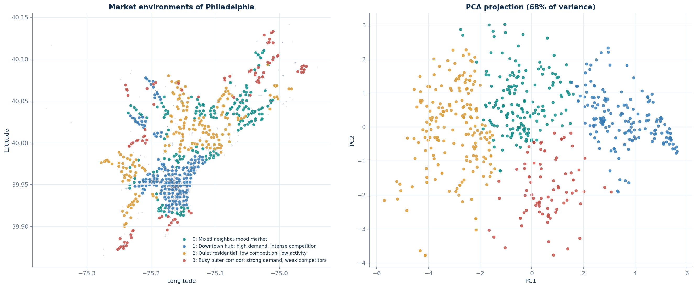
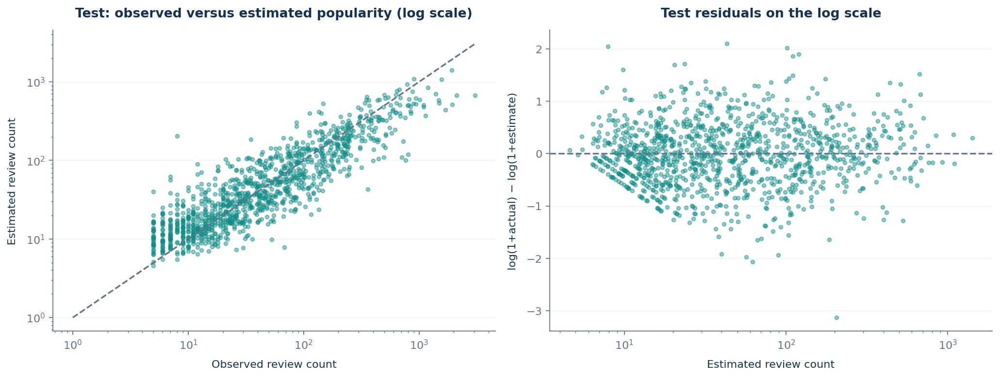
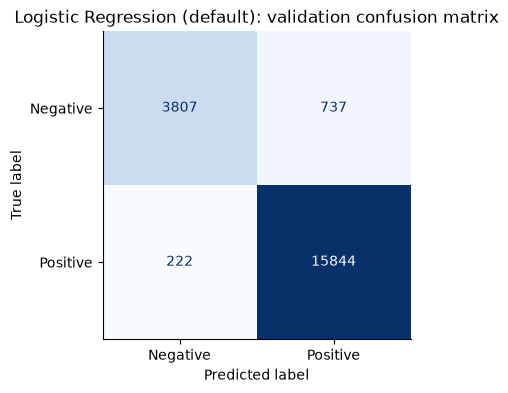
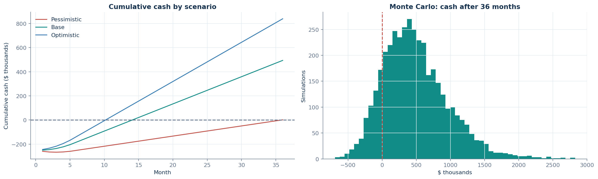

# 🍽️ BusinessLaunch AI — Should I open a restaurant or café here?

**NTI Machine Learning & Data Analysis Track · Final Capstone Project**

BusinessLaunch AI helps an entrepreneur evaluate a location in **Philadelphia, PA** before opening a restaurant or café. It combines regression, NLP, clustering and simulation on the [Yelp Open Dataset](https://www.kaggle.com/datasets/yelp-dataset/yelp-dataset) into one Streamlit app that answers:

> *"If a businessman opens a new restaurant or café at this location, what **opportunities**, **competition**, **customer expectations** and **financial risks** could they face?"*

## Why it matters
Restaurants are among the riskiest small businesses to open: in this very dataset only **61% of Philadelphia restaurants and cafés are still open** at the snapshot. Common causes (wrong location, underestimated competition, misread customer expectations, unrealistic costs) are visible in public data **before** signing a lease, but owners rarely have the tools to read that data. BusinessLaunch AI turns 14,570 businesses, ~700k reviews and 1.29M check-ins (2010–2022) into a location report a non-technical owner can use.

## What the app does
| Page | Question answered | Team member · method |
|---|---|---|
| **1 · Location Intelligence** | How much competition is there, and how popular could a new restaurant here become? | Member 1 · haversine BallTree features, Linear Regression / Random Forest / Gradient Boosting / **HistGradientBoosting** |
| **2 · Customer Reviews** | What do customers of nearby competitors praise and complain about? | Member 2 · TF-IDF + **Logistic Regression** / Naive Bayes sentiment, **NMF** complaint topics |
| **3 · Market Clusters** | What kind of market environment is this? | Member 3 · neighbourhood profiles, **K-Means** vs Agglomerative (Ward) vs Gaussian Mixture |
| **4 · Financial Simulator** | Do the numbers work, and how risky are they? | Member 3 · break-even, scenarios, **Monte Carlo** (4,000 runs), sensitivity |
| **🎮 Beat the AI** | Can your instincts beat the models? | Three games on real data: *Higher or Lower* (vs the Member 1 regression), *Complaint Detective* (vs the NMF topic model), *Pick the Spot* (vs the Member 3 risk scores), with points, streaks and badges |
| **5 · Launch Report** | Go / caution / high risk — and why? | All · explainable percentile scores, rules, alternative locations, downloadable report, **comparison of saved locations** |



## Results
| Component | Model selected | Key result (held-out data) | Baseline |
|---|---|---|---|
| Popularity regression (Member 1) | HistGradientBoosting, log target | **Test R² 0.61**, MAE 51.3 reviews | median baseline MAE 99.4 (−48%) |
| Sentiment classification (Member 2) | TF-IDF (1–2 grams) + Logistic Regression (C = 10) | **Test macro F1 0.944**, accuracy 0.964 | majority class 0.796 |
| Market clustering (Member 3) | StandardScaler + K-Means, k = 4 | silhouette 0.23 (best of 3 methods), bootstrap ARI 0.87 | Ward 0.17, GMM 0.17 |

Highlights
* **Leakage-safe evaluation.** Member 1 splits by ~1 km spatial blocks and Member 2 by business, so test restaurants were never seen in training. Leakage assertions (target perturbation, fold-local vocabularies, train-only imputation) all pass.
* **Feature engineering beat model choice.** Adding Yelp attributes, opening hours, a business-age proxy and nearby check-in activity raised the regression from R² 0.06 (location only) to 0.61.
* **Four market environments** emerge without coordinates as inputs: *Downtown hub* (high demand, intense competition, 56% still open), *Busy outer corridor* (strong demand, weak competitors: the best opportunity/risk balance), *Mixed neighbourhood market* and *Quiet residential*.
* **The risk score is back-tested on real outcomes.** Among 2,803 restaurants and cafés that opened in 2012–2019, 27% closed in low-risk areas vs 45% in high-risk areas (AUC 0.60). High-*demand* areas close *more* often, so the verdict always weighs opportunity against risk.
* **Robustness checks.** A 20-configuration random search and a Poisson loss did not beat the selected regression. The popularity estimate comes with a conformally calibrated 80% range, and the clusters survive changing the radius to 1.5 km (ARI 0.60).
* **Six complaint themes** from 127k negative reviews: service & staff attitude, food taste & quality, wait times & table service, orders/delivery/phone, cheesesteaks & sandwiches, pizza quality.

| | | |
|---|---|---|
|  |  |  |

## Repository structure
```
BusinessLaunchAI/
├── app/                         Streamlit application
│   ├── Home.py                  entry point + grouped navigation (streamlit run app/Home.py)
│   ├── common.py                shared loaders, sidebar location picker, saved locations
│   ├── ui.py                    design system: CSS, headers, cards, game points
│   ├── views/                   home, location, reviews, clusters, finance, report, games
│   └── saved_locations.json     saved locations (3 demo locations included)
├── .streamlit/config.toml       app theme (colours, fonts, chart palette)
├── run_app.bat                  double-click launcher for Windows
├── src/businesslaunch/          reusable, tested Python package
│   ├── data.py                  streaming Yelp JSON / ZIP readers
│   ├── location.py              Member 1 features for a hypothetical restaurant + model wrapper
│   ├── competitor_analysis.py   Member 2 competitor review analysis
│   ├── market.py                Member 3 neighbourhood profiles, concept gaps
│   ├── finance.py               Member 3 simulator (projection, scenarios, Monte Carlo)
│   └── recommend.py             Member 3 explainable recommendation
├── notebooks/
│   └── BusinessLaunchAI_ML_Pipeline.ipynb   the complete ML work in one notebook (Parts 1–3)
├── outputs/member1|member2|member3/   trained models, metrics, figures, CSVs used by the app
├── tests/                       unit tests + app smoke test
├── data/                        Yelp files go here (not committed, see data/README.md)
├── docs/                        architecture, presentation outline, images
└── requirements.txt
```

## Setup
Requires Python 3.11.

```bash
git clone https://github.com/<your-username>/BusinessLaunchAI.git
cd BusinessLaunchAI
python -m venv .venv
.venv\Scripts\activate            # Windows  (macOS/Linux: source .venv/bin/activate)
pip install -r requirements.txt
```

### Run the app (no dataset download needed)
The trained models and exported tables in `outputs/` are committed, so the app runs straight away. Run it **from the project root** so the theme in `.streamlit/config.toml` is applied:
```bash
streamlit run app/Home.py
```
On Windows you can also double-click `run_app.bat`.
Open http://localhost:8501, choose an area (or type coordinates) in the sidebar and go through the five pages. Use **💾 Save location** in the sidebar and **Save these assumptions** on the Financial Simulator page; the Launch Report then uses your numbers and compares all saved locations. Three demo locations are pre-saved in `app/saved_locations.json`. After changing any code, stop and restart the app (Streamlit keeps shared modules in memory).

### Reproduce the models
1. Download the Yelp Open Dataset and place the files in `data/` (see [data/README.md](data/README.md)).
2. Open `notebooks/BusinessLaunchAI_ML_Pipeline.ipynb` and *Run All*: Part 1 (≈5 min) → Part 2 (needs the 5 GB review file, ≈20–40 min; skip it if you don't have the file, Part 3 reads its saved results) → Part 3 (≈3 min). Each part writes to `outputs/memberN/`.
3. Run the tests: `python -m pytest tests` (or `python tests/test_core.py` and `python tests/test_app_pages.py`).

## Methodology in brief
**Data.** Philadelphia, PA businesses (14,570 after cleaning). The restaurant/café universe is 6,174 businesses (5,855 tagged `Restaurants` plus 319 cafés/coffee shops). There are 703,584 cleaned reviews and 1.29M check-ins, with the snapshot ending January 2022.

**Member 1 — regression.** The target is cumulative `review_count`, a popularity proxy (log-transformed). Features include competitor counts within 0.5/1/2 km, open competitors, density, distance to City Hall, own rating and price, 13 service attributes, alcohol/noise/Wi-Fi/parking, opening hours, years since first check-in, nearby check-in activity and 20 category tags. The model is selected by 3-fold spatial CV on training blocks, then validation MAE. Each restaurant's own check-in count is excluded because it duplicates the target.

**Member 2 — NLP.** Labels come from stars (1–2 negative, 4–5 positive; 3 excluded from training). Text is lowercased with negation preserved ("don't" → "do not"), then vectorised with TF-IDF (unigrams + bigrams). Models are tuned with GroupKFold by business and selected on validation macro F1. NMF on negative reviews produces the complaint topics, which are aggregated per business and per location.

**Member 3 — clustering, finance, recommendation.** 611 grid areas (0.5 km cells) are each profiled with 13 features within 1 km: supply, survival, concept mix, price, rating, % negative reviews, demand, diversity and complaint mix. The pipeline is median-impute → StandardScaler → clustering, with k chosen by a pre-stated rule: k ≥ 4, bootstrap ARI ≥ 0.8, smallest cluster ≥ 5%, then the highest silhouette. Opportunity and risk scores are percentiles against all areas. The financial model is driven by user assumptions; data informs only the default ticket (local price level) and a bounded ±40% traffic adjustment (local demand percentile). A Monte Carlo simulation gives the probability of payback within 24 months.

See [docs/ARCHITECTURE.md](docs/ARCHITECTURE.md) for the data flow between members.

## Limitations
* Review count measures **popularity on Yelp, not revenue**. Yelp has no sales, rent or cost data, so all money figures are user assumptions.
* The data is a single January 2022 snapshot. Closure dates are unknown, and older businesses have had more time to collect reviews (handled with the business-age feature).
* Aspect sentiment uses a keyword lexicon and a sentence-level classifier trained on whole reviews, so very short sentences ("a bit expensive though") can be misread.
* A transformer model (DistilBERT) was not trained: it needs the 5 GB review file and a GPU; this machine has 8 GB RAM and no GPU.
* Sentiment labels come from star ratings: sarcasm and mixed reviews are the main source of errors, and the 2★/4★ boundaries are hardest.
* Neighbourhood circles overlap, so clusters describe tendencies (silhouette 0.23). The opportunity/risk weights are transparent rules, not learned from outcomes.
* Only Philadelphia city limits are covered, so competitors just across the city boundary are missed.

## Future work
* Validate recommendations against restaurants that opened after the snapshot (city business-licence data).
* Add census income, foot traffic and rent data to replace financial assumptions with local estimates.
* Use dated reviews for trend features ("is this area getting better?") and fine-tune a transformer (e.g. DistilBERT) for aspect-level sentiment.
* Deploy to Streamlit Community Cloud and add an LLM summary of competitor reviews.

## Team
| Member | Responsibility |
|---|---|
| Member 1 | Location intelligence & regression (business + check-in data) |
| Member 2 | NLP, sentiment classification & complaint topics (review data) |
| Member 3 | Clustering, financial simulation, recommendation & app integration |

*Data: Yelp Open Dataset, used under the Yelp Dataset Terms of Use for academic purposes.*
