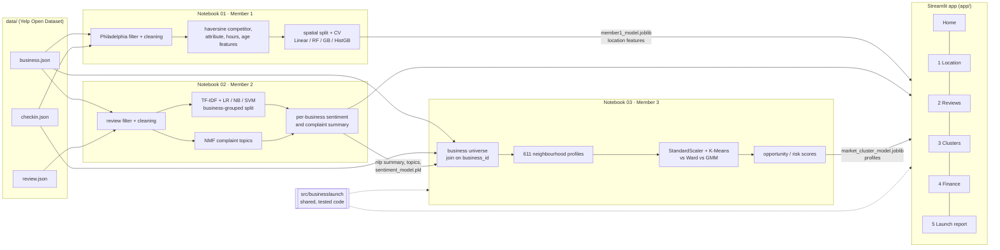

# Architecture and data flow

## Design decisions
* **One shared package (`src/businesslaunch`).** The notebook and the app call the same functions (`MarketIndex.profiles`, `analyze_location`, `finance.monte_carlo`, `recommend.build_report`), so an analysis shown in the app is identical to the one evaluated in the notebook. Member 2's notebook checks that the saved files reproduce the in-memory analysis exactly.
* **Join key `business_id`.** Member 2's list (Restaurants + Cafes + Coffee & Tea, 6,174) is the competition universe. Member 1's 5,855 restaurants are a strict subset and keep their own regression catalog.
* **Models are trained offline and loaded read-only.** The app never retrains: it loads joblib/pickle bundles (scikit-learn pinned to 1.9.1) and CSV exports, starts in seconds, and runs without the 5 GB review file.
* **Hypothetical-restaurant features.** `location.PopularityModel` rebuilds Member 1's feature definitions for a point that is not in the catalog. Nothing is excluded by ID, because the restaurant is new.
* **Saved locations.** The sidebar can save a location (and the Financial Simulator its assumptions) to `app/saved_locations.json`. The Launch Report uses saved assumptions when present and compares all saved locations side by side. Three demo locations ship with the repository.
* **Aspect sentiment.** `aspects.py` splits reviews into sentences, matches seven aspects with a keyword lexicon and scores each sentence with Member 2's pipeline, so the app can show *what* customers like or dislike near a location.
* **Honest uncertainty.** Every money figure is a user assumption. Scores are percentiles with stated weights, and the Monte Carlo simulation turns assumptions into probabilities instead of single numbers.

## Leakage controls
| Where | Control |
|---|---|
| Member 1 | ~1 km spatial blocks kept intact across train/validation/test; fold-local category vocabularies; train-only imputation; target-derived neighbour features excluded; target-perturbation assertions |
| Member 2 | split by `business_id` (GroupShuffleSplit, GroupKFold); TF-IDF refitted inside each CV fold; decision threshold tuned on validation only |
| Member 3 | clustering is unsupervised; selection rule fixed before inspecting clusters; bootstrap stability reported |
